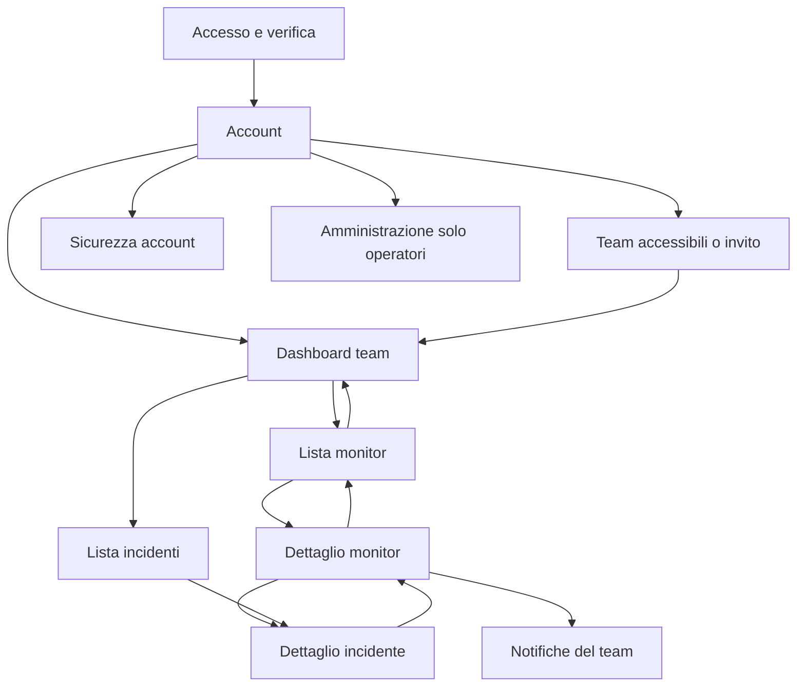

# Dashboard utenti — brief e piano di realizzazione

Decisione dell’utente del 2026-11-09: dare priorità a una dashboard e a una navigazione che rendano fruibile l’applicazione, partendo dallo screenshot UptimeRobot allegato nella conversazione e adattandolo progressivamente. Il riferimento rimane nella conversazione: non viene copiato nel repository. Il piano operativo e gli stati sono nel [macro task UI](TASKS.md#ui--dashboard-utenti-e-interfaccia-applicativa-scope-2026-11-02-priorità-aggiornata-2026-11-09).

**Stato al 2026-11-10:** UI.01.1 e UI.01.2 completati: inventario e progetto di percorsi/gerarchia sono riportati sotto. Il prossimo sotto-task è **UI.01.3**, token e componenti condivisi con documentazione in `UI-GUIDELINES.md`. Layout, componenti e nuove schermate rimangono da implementare.

## Ripartenza della prossima sessione

Leggere inventario UI.01.1 e progetto UI.01.2 di questo brief, il piano e l’handoff. Realizzare in UI.01.3 token e primitive condivise con regole in `UI-GUIDELINES.md`, test significativi e controlli frontend. Percorsi, ritorni, contesti e stati sono già definiti; shell e migrazione delle pagine seguono in UI.02. Nessuna schermata nuova è certificata dalla sola progettazione.

La stima della fase A è 73–108 h incluso inventario, non un consuntivo. Le correzioni del collaudo sono implementate e l’utente conferma A–K conclusi; AppLayout e nuova dashboard non sono certificati da tali risultati.

La prima vista di riferimento è il dettaglio monitor dello screenshot descritto sotto; la sequenza utente è dashboard → lista → dettaglio → incidente e ritorno. L01–L08 sarà aggiornato ed eseguito in UI.06 dopo l’intera fase A. Per verifiche già eseguite e ambiente rimasto alla chiusura, leggere [BOOTSTRAP.md](BOOTSTRAP.md) e [TASKS.md](TASKS.md).

## Obiettivo per l’utente

Dopo l’accesso l’utente deve poter riconoscere il team attivo, capire se ci sono problemi, trovare il monitor interessato, leggere grafici e incidenti e compiere le azioni consentite dal proprio ruolo. Menu, ritorni e contesto devono evitare la necessità di ricordare URL o cercare un grafico in una pagina diversa dal monitor.

La prima porzione visibile da costruire dopo la definizione dei componenti è il percorso **layout comune → dashboard del team → lista monitor → dettaglio monitor**. Si completa poi la coerenza delle sezioni operative. Lo screenshot mostra un dettaglio monitor: il riepilogo dell’intero team e gli altri flussi vanno progettati esplicitamente, senza trattare quella singola immagine come il progetto di tutta l’applicazione.

## Cosa riprendere dal riferimento

| Elemento osservabile | Adattamento per l’applicazione | Fonte o vincolo |
|---|---|---|
| Menu laterale | Dashboard, Monitors, Incidents, Maintenance, Notifications, Status pages e Team, con sezione corrente evidente | Rotte esistenti e inventario di UI.01.1; un eventuale elenco manutenzioni team è una nuova proiezione autorizzata, non un nuovo motore |
| Intestazione monitor | Stato, nome, tipo, destinazione redatta, breadcrumb e azioni pertinenti | Presenter/policy monitor; un viewer non riceve azioni di modifica |
| Scheda stato | Up/Down/Unknown e stato operativo separato: pausa, sospensione, manutenzione | Non confondere ultimo risultato con attività o disponibilità attuale |
| Ultimo controllo | Data, tempo trascorso e frequenza configurata | Timestamp reali e dati mancanti espliciti; nessun finto aggiornamento |
| Barre ultime 24 ore | Andamento leggibile, dettaglio per intervallo e alternativa testuale | Semantica dichiarata: stati e buchi, non barre tutte verdi in assenza di osservazioni |
| Uptime per periodo | Percentuale, copertura, downtime e incidenti per finestra supportata | `MonitorAvailability`, dati grezzi/rollup e retention; non media di percentuali |
| Grafico tempi di risposta | Serie per regione/finestra, unità, campioni e tabella accessibile | Riutilizzo dei servizi M6/M7; distinguere assenza di misure, zero e disconnessione |
| Pannello certificato | Scadenza TLS osservata, quando applicabile | Il modello dispone di `ssl_expires_at`; censire proiezione e freschezza in UI.03.1. Non esiste per questo una funzione di scadenza registrazione dominio |
| Prossima manutenzione | Stato corrente e prossima finestra con collegamento alla gestione | Finestre esistenti, fuso esplicito e permessi di M4 |
| Destinatari/notifiche | Policy e canali effettivi, configurazione assente spiegata e collegamento utile | Nessun avatar/destinatario inventato o esposizione di credenziali |
| Comandi in alto | Modifica, pausa/ripresa e altre azioni realmente disponibili, con feedback | Policy, limiti e conferme esistenti. Il pulsante test-notifica del riferimento non introduce una nuova funzione |

Tema scuro, schede e accento per gli stati sono un punto di partenza. Colori propri, spaziatura, densità, etichette e disposizione verranno affinati durante l’implementazione. Nessun nuovo logo o decisione implicita sul nome: UI.07 rimane distinto e non blocca la dashboard.

## Struttura e percorsi

**Layout comune.** Sidebar desktop e menu mobile, team sempre identificabile, cambio team fra membership correnti, menu account/sicurezza e uscita. L’amministrazione della piattaforma è un contesto distinto e disponibile solo agli operatori. Le pagine di accesso e le pagine pubbliche mantengono layout dedicati.

**Dashboard team.** Sintesi operativa, monitor in difficoltà e incidenti aperti prioritari, ultimo aggiornamento e accessi alle azioni consentite. Primo utilizzo con una spiegazione e un ingresso alla creazione. Un account senza team ha un percorso chiaro per selezionare un team accessibile o rivedere un invito; la creazione del team iniziale resta nel flusso di registrazione ordinaria, senza introdurre una creazione autonoma di ulteriori team.

**Lista monitor.** Ricerca, filtri e paginazione conservati nell’URL. Stato distinguibile dal solo colore, tipo, destinazione sicura, ultimo check e azioni pertinenti. Clic sul nome apre il dettaglio completo con grafici; tornare alla lista conserva il contesto di ricerca.

**Dettaglio monitor.** Intestazione e comandi, schede, andamento 24 ore, grafici e statistiche, pannelli contestuali e incidenti recenti. A larghezza ridotta la gerarchia diventa una sequenza verticale utilizzabile; nessuna azione essenziale resta fuori schermo. La vecchia selezione dei grafici nella dashboard deve restare compatibile o avere un percorso di migrazione esplicito, senza rompere link esistenti.

**Flussi collegati.** Dall’incidente si torna al monitor e dal monitor si raggiungono manutenzione e notifiche. Le sezioni membri/inviti, status page e account diventano parti coerenti dell’applicazione. Gestione privata della status page, anteprima e pagina pubblica devono essere distinguibili.

## Regole che ogni porzione deve conservare

- Backend autorevole per ruoli, quote e isolamento: il menu non sostituisce le policy. Nuove letture/aggregazioni, se necessarie, restano dello stesso team e restituiscono proiezioni esplicite.
- Dati reali: finestre compatibili con creazione del monitor e retention; copertura/dati mancanti dichiarati. Nessun uptime 100%, data di scadenza, durata Up, destinatario o dato commerciale inventato.
- Servizi coesi per SLA, latenza e proiezioni; React presenta e gestisce l’interazione. Controller sottili, Form Request per nuovi filtri e nessuna regola duplicata nei widget.
- Reverb e recupero già implementati rimangono funzionanti senza polling periodico; un aggiornamento non deve sovrascrivere una bozza in modifica. Cambio team o revoca non lasciano dati del team precedente visibili.
- Validazione durante la digitazione dove implementata, errori vicino ai campi e annunci accessibili; conservazione del draft, invio singolo e password inline. Un problema di rete con esito incerto non autorizza un replay automatico.
- Ogni controllo è raggiungibile da tastiera, con etichetta e focus visibile. Menu mobile, grafici e tabelle hanno comportamento accessibile e alternativa testuale. Il collaudo finale è successivo, ma queste regole valgono fin dai primi componenti.
- Solo dipendenze motivate da una necessità concreta: React 19, Inertia 2, Tailwind 4 e componenti/grafici esistenti sono la base. Una nuova libreria richiede valutazione, compatibilità e aggiornamento della documentazione, non un’adozione implicita dal riferimento.

## Sequenza di lavoro e criteri di uscita

| Fase | Task operativi | Risultato verificabile |
|---|---|---|
| Inventario e progetto | UI.01.1–UI.01.3 | Dati/rotte/ruoli censiti, gerarchia desktop/mobile e componenti documentati, stima aggiornata e prima porzione definita |
| Struttura applicativa | UI.02.1–UI.02.4 | Navigazione e cambio team reali, menu mobile e contesti account/piattaforma corretti |
| Dashboard e monitor | UI.03.1–UI.03.8 | Overview, lista e dettaglio con metriche reali, grafici, azioni e realtime verificati |
| Sezioni operative | UI.04.1–UI.04.4 | Incidenti, manutenzioni, notifiche, status page, team/account e operatori integrati |
| Chiusura fase A | UI.06.1–UI.06.4 | Test pertinenti, smoke dei flussi modificati e L01–L08 sulla nuova UI; difetti bloccanti risolti |
| Completamento successivo | UI.04.5 e UI.05; UI.07 separato | Billing/API e pagine pubbliche integrati quando le relative funzioni esistono; identità definitiva o rinvio registrato prima di M12 |

La fase A precede M9 per decisione esplicita dell’utente. La fase successiva dipende da M9/M10 dove richiesto e non può essere una dipendenza della fase A: il piano deve restare eseguibile senza cicli. Le milestone funzionali originali, PDF e portale clienti restano nel perimetro.

Ogni sotto-task comprende implementazione, documentazione, test e controlli pertinenti; nessun rinvio dei test automatici a fine macro. Le misure di query e prestazioni devono essere riproducibili e reali. La valutazione dei tempi viene fatta con l’inventario: non si sommano nuove attività alle ore della specifica fingendo che fossero già comprese.

## Collaudo dopo la nuova interfaccia

Su richiesta dell’utente, **L è rinviato a UI.06**, dopo la dashboard e i flussi della fase A. Tutti gli otto casi vanno riferiti alla nuova interfaccia; i PASS già ottenuti restano evidenze della versione precedente, non certificano il nuovo layout.

Aggiornare [BROWSER-TESTS.md](BROWSER-TESTS.md) mantenendo gli ID esistenti e includendo dashboard e navigazione comune nella matrice delle schermate. Eseguire i casi A–K interessati dalle modifiche e L01–L08: tastiera, VoiceOver effettivo, mobile 390 px, zoom nativo 200%, doppio invio con rete lenta, offline/recupero, cronologia, console e confronto Brave/Firefox. Usare dati sintetici, registrare esiti e ripristini senza screenshot nel repository. La chiusura del collaudo non si deduce dalla sola build o da un mockup.

## Inventario verificato — UI.01.1, 2026-11-10

Inventario statico del codice, non collaudo runtime. UI.01.1 consegna questa mappa; non implementa AppLayout, nuovi widget o nuove query. I riferimenti sotto sono relativi al repository e descrivono il comportamento attuale. Le proposte restano assegnate ai sotto-task successivi.

### Schermate, ingressi e azioni

Nella tabella `T` significa `/teams/{team}`. Le pagine private elencate usano oggi `AuthLayout`, con menu locali; non esiste AppLayout. Le rotte team richiedono autenticazione, email verificata e `EstablishTeamContext`: il team nell’URL è autorevole rispetto alla preferenza salvata. Gli identificatori annidati restano soggetti ai binding tenant.

| Contesto e viste React | GET e ingresso server | Azioni e collegamenti attuali | Gap per il refactoring |
|---|---|---|---|
| `Dashboard/Show` | `T/dashboard`; [dashboard routes](../routes/dashboard.php), `DashboardController` | Riepilogo, incidenti, lista paginata, selezione grafici con `page`/`monitor`, download report mensile | Menu locale senza status page; grafici separati dal dettaglio, manca ingresso rapido di creazione autorizzato |
| `Monitors/Index` | `T/monitors`; [monitor routes](../routes/monitors.php), `MonitorPageController::index`, `ListMonitorsRequest` | Ricerca `q`, filtri `type`/`status`/`state`, pagina, quota e creazione; nome apre dettaglio | Ritorno dal dettaglio costruito senza filtri; summary senza destinazione |
| `Monitors/Create`, `Monitors/Edit` | `T/monitors/create`, `T/monitors/{monitor}/edit`; stesso controller | POST creazione, PUT/PATCH modifica; form per tipo, limiti intervallo e ritorni | Integrare layout preservando draft, segreti non riproiettati e validazione inline |
| `Monitors/Show` | `T/monitors/{monitor}`; `MonitorPageController::show` | Modifica, pausa/ripresa, DELETE con conferma, credenziale heartbeat POST/DELETE, incidenti recenti, manutenzioni, escalation | Nessuna serie metrica nel payload; TLS non proiettato; destinazione da proiezione sicura del dettaglio |
| `Incidents/Index`, `Incidents/Show` | `T/incidents`, `T/incidents/{incident}`; [incident routes](../routes/incidents.php), `IncidentPageController` | Filtri/pagina, ritorno al monitor; acknowledge, update, publish, severity, root-cause; timeline e massimo 100 consegne | Unificare navigazione e ritorni; non presentare il log limitato come storico completo |
| Manutenzioni, senza pagina autonoma | Pannello in `Monitors/Show`; `MaintenanceWindowController`, `MaintenanceSchedule` | POST/PATCH/DELETE sotto `T/monitors/{monitor}/maintenance`; modifica futura, fine anticipata corrente | Manca elenco team e relativa GET; Maintenance entra nel menu soltanto in UI.04.2 |
| `Notifications/Index` | `T/notifications`; [notification routes](../routes/notifications.php), `NotificationPageController` | CRUD canali/policy, verifica, quiet hours, rotazione segreto; assegnazione policy nel monitor; consegne nel dettaglio incidente | Menu comune, accesso guidato ai log esistenti; elenchi canali/policy caricati interamente, da considerare nelle misure UI.03.1/UI.04.2 |
| `StatusPages/Index` | `T/status-pages`; [status routes](../routes/status-pages.php), `StatusPageController` | Creazione/modifica/eliminazione, componenti, tema/password/pubblicazione e gestione/verifica dominio; apertura URL pubblico | Gestione privata e pagina pubblica devono restare distinguibili; non esiste pagina separata di modifica |
| `Teams/Index`, `Teams/Show` | `/teams`, `T`; [team routes](../routes/teams.php), `TeamController` | POST `T/select`, PATCH/DELETE membri, inviti POST/reinvio/DELETE; link a sezioni team e ownership | Selettore non condiviso; select redirige oggi a `/account`, non alla dashboard. Lista team risolve il ruolo con query per membership: punto da misurare, non N+1 dichiarato risolto |
| `Teams/Ownership` | `T/ownership`; `TeamController::ownership` | Trasferimento POST con password recente a un altro owner esistente | Preservare ritorno dopo riconferma e invarianti sul proprietario primario |
| `Account/Overview`, `Account/Security` | `/account`, `/account/security`; [auth routes](../routes/auth.php), `AccountController` | Team correntemente accessibile, invito pendente, logout POST; setup/conferma/disattivazione 2FA, recovery, password | Overview espone solo nome del team; manca ID per ingresso diretto alla dashboard. Security richiede password recente; credenziali lette separatamente via AJAX no-store |
| `Admin/Teams/Index`, `Admin/Teams/Show` | `/admin/teams`, `/admin/teams/{team}`; [admin routes](../routes/admin.php), `TeamDirectoryController` | Directory ricercabile/paginata, dettaglio, audit/override; PUT/DELETE override con riconferma inline | Contesto piattaforma distinto dal team, non accessibile tramite solo ruolo owner |
| `Teams/Invitation`, `Teams/Register` | `/invitations/accept`, `/invitations/register`, link bearer `/invitations/{invitation}/{token}`; `InvitationController`, `InvitedRegistrationController` | Revisione, cambio account, registrazione invitata, verifica email e accettazione esplicita | Flusso di ingresso con AuthLayout/AuthForm, fuori dal layout tenant; nessuna accettazione implicita |

Confini censiti: `Home`, le sette pagine `Auth/*` (Login, Register, ForgotPassword, ResetPassword, VerifyEmail, ConfirmPassword, TwoFactorChallenge) e `StatusPages/Public`, `StatusPages/Unlock`, `StatusPages/Subscription` rimangono nei flussi pubblici/accesso. Registrazione ordinaria crea il team iniziale; registrazione invitata no. Non esiste una rotta autonoma per creare un ulteriore team dall’account: lo stato senza team può offrire selezione o revisione invito esistenti, senza inventare un pulsante di creazione funzionante. Billing e token API non hanno ancora schermate operative.

### Permessi e autorità

Fonti backend: [MonitorPolicy](../app/Policies/MonitorPolicy.php), [IncidentPolicy](../app/Policies/IncidentPolicy.php), [NotificationChannelPolicy](../app/Policies/NotificationChannelPolicy.php), [EscalationPolicyPolicy](../app/Policies/EscalationPolicyPolicy.php), [StatusPagePolicy](../app/Policies/StatusPagePolicy.php), [TeamPolicy](../app/Policies/TeamPolicy.php), [TeamInvitationPolicy](../app/Policies/TeamInvitationPolicy.php) e [TeamAccess](../app/Services/Identity/TeamAccess.php). Le mutation action ricontrollano l’autorità corrente sotto lock; nascondere il comando non sostituisce tali controlli.

| Capacità | Owner | Admin | Member | Viewer | Indicazione frontend verificata |
|---|---|---|---|---|---|
| Leggere dashboard/monitor/incidenti/notifiche/status page private del team | Sì | Sì | Sì | Sì | Membership nelle rotte/request; letture consentite anche senza comandi |
| Creare/modificare/eliminare/pausare/riprendere monitor, gestire heartbeat e assegnazione policy | Sì | Sì | Sì | No | `can.create`, `can.update/delete/pause/resume`; quota distinta dal ruolo |
| Gestire manutenzioni | Sì | Sì | Sì | No | `can.update` del monitor, stesso gate in request/action; nessuna policy manutenzione distinta |
| Prendere in carico, annotare, pubblicare aggiornamenti, cambiare severità/causa incidente | Sì | Sì | Sì | No | `can.update`; applicabilità ulteriore secondo stato incidente |
| Gestire canali, segreti, quiet hours e policy escalation | Sì | Sì | No | No | `can.manage`; assegnare una policy al monitor segue invece MonitorPolicy |
| Gestire status page, componenti e dominio | Sì | Sì | No | No | `can.manage`, quota pagine separata |
| Gestire membri e inviti | Tutti i ruoli, con invarianti di dominio | Solo member/viewer, sia ruolo attuale sia destinazione | No | No | `roles`, `manageable`, inviti filtrati dal controller |
| Lasciare il team | Con vincoli di ownership | Sì | Sì | Sì | Controllo self separato; proprietario primario protetto |
| Trasferire ownership primaria | Solo proprietario primario | No | No | No | `ownerId === actorId`, successore owner esistente, password recente |
| Selezionare un team accessibile, account e sicurezza propri | Sì | Sì | Sì | Sì | Membership riletta, preferenza revocata risolta come assente |

L’operatore non è un quinto ruolo tenant: [PlatformAccess](../app/Services/Admin/PlatformAccess.php) e [EnsurePlatformAdmin](../app/Http/Middleware/EnsurePlatformAdmin.php) verificano flag persistito/email e 2FA confermata in produzione; non operatori ricevono 404. Il link Admin deriva dal flag della propria identità, le PUT/DELETE richiedono anche password recente. [HandleInertiaRequests](../app/Http/Middleware/HandleInertiaRequests.php) condivide nome prodotto, identità minima, status e coordinate pubbliche realtime, ma non elenco membership/ruolo/team attivo: UI.02 dovrà definire una proiezione condivisa sicura. Nessuna discrepanza di autorizzazione è stata dimostrata dall’inventario statico; le regressioni runtime restano da provare.

### Componenti riutilizzabili

| Gruppo | Fonte esistente | Riutilizzo e limite |
|---|---|---|
| Layout e stile | [AuthLayout](../resources/js/components/auth/AuthLayout.tsx), [app.css](../resources/css/app.css) | Tema slate/emerald e width narrow/wide; marchio attuale hardcoded, token semantici assenti. AppLayout separato e nome da configurazione nei task UI.01.3/UI.02 |
| Form e sicurezza | `components/auth/AuthForm`, `PasswordConfirmationForm`; `monitors/MonitorForm`, `intervalValidation`; form notifications/status-pages | Conservare errori per campo, draft, disable durante invio e password inline. Non creare un secondo motore form |
| Stati e tabelle | `monitors/MonitorBadges`, `incidents/IncidentBadges`, `IncidentTable`, `TableScrollArea`, `monitors/Pagination` | Etichette oltre al colore, contenimento orizzontale e paginazione; manca ancora una famiglia condivisa di button/input/card/alert |
| Grafici e report | [TimeSeriesChart](../resources/js/components/dashboard/TimeSeriesChart.tsx), `MonthlyReportDownload` | SVG, selezione serie, null come buchi, tabella equivalente e UTC; nessun calcolo SLA nel browser. Barre stato 24 h da costruire |
| Pannelli dominio | `incidents/MaintenancePanel`, `notifications/EscalationPanel`, `DeliveryLog`, `monitors/HeartbeatPanel`, form dominio/status page | Conservare dati redatti e distinzioni pubblico/privato; proiezione escalation monitor oggi contiene policy effettiva, non elenco canali effettivi |
| Rete e realtime | `RequestFailureNotice`, `LiveUpdates`, [useLivePage](../resources/js/hooks/useLivePage.ts), [LivePageSession](../resources/js/realtime/LivePageSession.ts) | Recupero autorizzato event-driven, senza polling; root specifiche per dashboard, lista/dettaglio monitor e incidenti. Nuovi payload metrici richiedono aggiornamento esplicito delle root recuperate e test di revoca/cambio team; form locali non vanno sovrascritti |

### Mappa riferimento → dati → gap

| Scheda o comportamento | Fonte verificata e semantica attuale | Classificazione e destinazione |
|---|---|---|
| Stato, nome, tipo, frequenza, ultimo check | [MonitorPresenter](../app/Http/Presenters/Monitoring/MonitorPresenter.php) summary/detail; `MonitorOperationalState` separa active/paused/suspended da lastStatus | Disponibile; UI.03.4 aggiunge presentazione, senza equiparare ultimo esito a disponibilità corrente |
| Destinazione sicura e comandi | `MonitorConfigurationProjection` nel dettaglio, `can` dai gate, `MonitorLimits`/`TeamEntitlement` per quota | Da estendere per la lista in UI.03.1, senza decrittare/esporre configurazioni indiscriminatamente; comandi già presenti |
| Conteggi team e incidenti aperti | [DashboardOverview](../app/Services/Dashboard/DashboardOverview.php): conteggi disgiunti, sospensione prima della pausa; incidenti massimo cinque, più conteggio totale | Disponibile; UI.03.2 riordina priorità, non calcola uptime team con medie percentuali |
| Barre 24 h e uptime | [MonitorAvailability](../app/Services/Metrics/MonitorAvailability.php) `hourly`/`between`, `AvailabilityReport`, `ExclusionPeriods`; dashboard proietta percentuali/copertura/SLA e durate aggregate | Da estendere: le percentuali orarie non sono una timeline Up/Down. Definire bucket con dati mancanti/esclusioni in UI.03.1 e resa UI.03.4, senza trasformare un’ora parzialmente osservata in verde pieno |
| Latenza e regione | [DashboardLatency](../app/Services/Dashboard/DashboardLatency.php): 24 bucket orari mobili, medie di misure observed per EU/US e campioni, null distinto da zero | Disponibile solo nella dashboard; UI.03.1/UI.03.5 porta la lettura al dettaglio. 7/30 giorni non sono già supportati da questo servizio |
| Uptime per finestra, downtime e copertura | `MonitorAvailability::between`: durate temporali, vita del monitor, pause/manutenzioni/sospensioni; ore intere dai rollup e bordi dal grezzo | Servizio disponibile, nuova proiezione UI.03.1. Retention grezza leggibile 30 giorni anche con partizioni fisiche presenti; storia rollup secondo piano. Finestra non ricostruibile interamente indisponibile |
| p50/p95 e storico esteso | [RollupStore](../app/Services/Metrics/Rollups/RollupStore.php), [HourlyRollupCalculator](../app/Services/Metrics/Rollups/HourlyRollupCalculator.php), rollup orari/giornalieri | Dati aggregati esistenti, contratto grafico esteso assente; verificare statistiche e aggregabilità in UI.03.1, senza mediare percentili o medie di medie |
| Scadenza certificato | [ExecutionResults](../app/Services/Monitoring/Results/ExecutionResults.php) aggiorna `ssl_expires_at` solo per TLS e conserva il valore quando manca una nuova lettura; risultati hanno `tls_expires_at` | Campo disponibile ma non proiettato. UI.03.1 deve identificare la provenienza/freschezza osservata: `last_checked_at` da solo non prova una nuova lettura certificato. UI.03.6 mostra null/obsoleto onestamente |
| Manutenzione corrente/prossima | [MaintenanceSchedule](../app/Services/Incidents/MaintenanceSchedule.php) e `MaintenanceWindowPresenter`; dettaglio riceve fino a 50 finestre in corso/future e cinque terminate | Disponibile per monitor; distinguere fase corrente dalla prossima in UI.03.6. Elenco team assente, da aggiungere in UI.04.2 |
| Notifiche effettive | [NotificationPresenter](../app/Http/Presenters/Notifications/NotificationPresenter.php)::monitorEscalation risolve override/default o nessuna policy; pagina Notifications proietta canali e step | Da estendere con step/canali effettivi redatti in UI.03.1/UI.03.6; una policy selezionata non garantisce una consegna. Non esporre credenziali o inventare destinatari |
| Incidenti recenti | `IncidentListing::recentForMonitor`, `IncidentPresenter`, massimo cinque nel dettaglio | Disponibile; UI.03.6/UI.04.1 curano collegamenti, durata e stato reali |
| Ultimo aggiornamento e connessione | `dashboard.generatedAt`, timestamp monitor e fase `useLivePage` | Disponibile, distinguere generazione proiezione, osservazione e connessione |
| Durata continua Up, scadenza registrazione dominio, avatar destinatari, test-notifica | Nessuna proiezione/funzione affidabile censita | Assenti dal contratto corrente: non introdurre tali funzioni per imitare lo screenshot |

Compatibilità da preservare: `T/dashboard?page=…&monitor=…` continua a identificare i grafici selezionati; spostarli nel dettaglio non autorizza la rimozione di questi URL. La ricerca monitor resta nell’URL (`q`, `type`, `status`, `state`, `page`); l’attuale “Back to monitors” perde tale selezione. Il meccanismo di ritorno sarà definito in UI.01.2, senza accettare destinazioni esterne arbitrarie.

### Porzioni, dipendenze e stima aggiornata

Stime ingegneristiche iniziali in ore, non misure di tempo eseguito né impegno di calendario. Ogni intervallo include implementazione/documentazione e verifiche pertinenti; UI.06 aggiunge il collaudo trasversale, non sostituisce i test per porzione.

| Ordine | Porzione | Sviluppo/documentazione | Verifiche/collaudo | Totale e dipendenza |
|---|---|---:|---:|---|
| 1 | UI.01.1 inventario | 2–3 h | 1 h | 3–4 h; M1–M8 |
| 2 | UI.01.2 percorsi e gerarchia | 2–3 h | 1 h | 3–4 h; inventario |
| 3 | UI.01.3 token e componenti di base | 4–6 h | 2–3 h | 6–9 h; flussi, regole in UI-GUIDELINES |
| 4 | UI.02.1–UI.02.4 layout, team, mobile e migrazione | 7–10 h | 4–6 h | 11–16 h; UI.01 |
| 5 | UI.03.1 letture, contratti e misure | 5–8 h | 3–4 h | 8–12 h; layout definito e fonti metriche |
| 6 | UI.03.2–UI.03.3 overview/lista | 4–6 h | 2–3 h | 6–9 h; layout e proiezioni |
| 7 | UI.03.4–UI.03.6 dettaglio/grafici/pannelli | 7–10 h | 4–6 h | 11–16 h; letture e overview/lista |
| 8 | UI.03.7–UI.03.8 azioni/realtime | 3–5 h | 3–4 h | 6–9 h; verifica incrementale anche durante le porzioni 6–7 |
| 9 | UI.04.1–UI.04.4 sezioni operative | 7–11 h | 4–6 h | 11–17 h; UI.02, coordinato con UI.03 |
| 10 | UI.06.1–UI.06.4 accettazione e ripristini | 2–3 h | 6–9 h | 8–12 h; fase A funzionale completa |
| | **Fase A complessiva stimata** | **43–65 h** | **30–43 h** | **73–108 h**, incluso inventario |

L’elenco Maintenance si implementa nella porzione 9 e solo allora entra nella sidebar: nessuna dipendenza circolare con UI.02. Il prossimo passo concreto è UI.01.2, poi UI.01.3; non si salta direttamente a nuovi controller o al restyling delle pagine. Fase B (UI.04.5/UI.05), identità UI.07 e lavoro M9–M12 non sono inclusi nella stima.

La specifica somma 178 h per M0–M12: l’aggiunta della fase A porta la previsione di perimetro a **251–286 h**, non le ore residue né il consuntivo; non include eventuali altre estensioni, fase B o ristime delle milestone originali. Nessuna previsione di 8–9 settimane viene riconfermata. Rivedere gli intervalli dopo layout e prime query: i principali fattori d’incertezza sono freschezza TLS, serie storiche estese, liste attualmente non paginate e accettazione con VoiceOver/browser reali.

### Verifiche richieste alle porzioni successive

Riutilizzare le suite DOM Dashboard/Monitors/Incidents/Notifications/StatusPages/Teams/Admin, i test RealtimePages/RealtimeAcceptance/LivePageSession e le integrazioni DashboardTest, MonitorPagesTest, MonitorAvailabilityTest, MaintenanceWindowTest, TeamAuthorizationMatrixTest e PlatformAdminAccessTest secondo le parti toccate. Aggiungere test per nuove proiezioni/rotte, dati mancanti, retention, dinieghi viewer/non membro e isolamento tenant. In UI.03.1 misurare query/righe/tempi su fixture riproducibili prima e dopo: questo inventario non produce benchmark o attestazioni di assenza di N+1.

Per UI.01.1: lettura statica e verifica documentale, senza avvio servizi, interrogazione dati, screenshot o esecuzione delle suite applicative. Le evidenze del 2026-11-09 restano storiche. UI.01.2/UI.01.3 e la fase A restano aperte; L01–L08 rimane in UI.06.

## Percorsi e gerarchia definiti per l’implementazione — UI.01.2, 2026-11-10

Questa sezione definisce il progetto da realizzare in UI.01.3/UI.02/UI.03/UI.04. Non attesta un layout già implementato. Le scelte derivano dall’inventario e dall’obiettivo di rendere raggiungibili le funzioni esistenti; non aggiungono nuovi motori o funzioni di dominio. Etichette applicative in inglese, come nelle viste attuali; documentazione in italiano. Tema scuro iniziale, nome testuale da configurazione e nessun nuovo logo. Token, contrasto e API dei componenti saranno concretizzati in UI.01.3 in `UI-GUIDELINES.md`.

### Mappa dei percorsi e contesti

Le frecce indicano collegamenti di navigazione, non autorizzazioni né accettazione automatica di un invito. Le altre sezioni team sono sempre raggiungibili dal menu comune. Il proprietario di un team non acquisisce accesso piattaforma.

| Contesto | Ingresso e identità visibile | Navigazione e uscita |
|---|---|---|
| Team | ID dell’URL autorizzato, nome e ruolo corrente; la preferenza salvata non sostituisce il team della pagina | Dashboard, Monitors, Incidents, Notifications, Status pages, Team. Maintenance entra dopo UI.04.2, tra Incidents e Notifications. Selettore team e menu account sempre raggiungibili |
| Account | `/account`, `/account/security`, `/teams`, ownership con esplicito nome team | Your account, Your teams, Account security; ingresso “Open dashboard” per un team correntemente accessibile. Ownership è una sotto-pagina di Team con conferma dedicata, non un potere globale dell’account |
| Piattaforma | `/admin/teams` e dettaglio; titolo “Platform administration”, nessun team cliente presentato come team attivo dell’operatore | Directory e breadcrumb del team ispezionato, “Your account” per uscire; nessun cambio team implicito. Override e audit restano separati dalla normale gestione del team |
| Accesso/pubblico | Auth, invito/registrazione invitata e status page pubbliche conservano layout dedicati | Conservare verifica, password, URL firmati, password status page e tema pubblico; nessuna sidebar privata o identità tenant resa pubblica |

Dopo login resta il comportamento di [AuthenticatedResponse](../app/Http/Responses/Auth/AuthenticatedResponse.php): destinazione intended quando presente, altrimenti `/account`; un link diretto autorizzato continua quindi ad aprire la risorsa richiesta. Account offrirà il collegamento evidente alla dashboard usando un ID verificato dal server. Invito pendente resta un percorso esplicito di revisione, prima e dopo la verifica email. La conferma password mantiene i ritorni di [PasswordConfirmedResponse](../app/Http/Responses/Auth/PasswordConfirmedResponse.php): sicurezza oppure ownership selezionata dal server, mai un return URL arbitrario. L’override conserva la conferma inline e un solo invio della mutazione.

**Cambio team (UI.02.2).** Il selettore elenca solo membership correnti, con nome e ruolo, marcando il team dell’URL nelle pagine team. Dal contesto account marca la preferenza accessibile; nel contesto piattaforma resta un collegamento a Your teams, senza suggerire che il team ispezionato sia una membership. Scegliere un altro team invia il POST esistente `/teams/{team}/select`; il redirect di successo verrà reso esplicitamente verso la dashboard di quel team, anche per la selezione in Your teams. Questo è un adeguamento pianificato del redirect attuale verso account, da coprire nei test di UI.02.2. Non trasportare filtri o ID risorsa del team precedente. Durante il cambio disabilitare ulteriori selezioni, annunciare “Switching team…” e coprire il contenuto tenant finché non è confermata la nuova destinazione; chiudere la vecchia sottoscrizione e ignorarne le risposte tardive. Un errore di rete non cambia ottimisticamente nome/ruolo: mostra esito non confermato e consente una lettura esplicita delle membership/stato corrente prima di riprovare. Su revoca eliminare la vista privata e offrire Your teams; non recuperare dati tenant da cache locale.

### Percorso principale e ritorni

| Passaggio | Contenuto prioritario e azione | Ritorno e contesto |
|---|---|---|
| Dashboard → Monitors | Stato operativo team, incidenti aperti, monitor Down/Unknown e accesso “All monitors”; “Create monitor” solo con permesso e quota | Sidebar Dashboard sempre disponibile; nessuna percentuale di uptime globale inventata |
| Lista → Dettaglio | Nome monitor come link principale, ricerca/filtri/pagina nell’URL; stato testuale, tipo, destinazione redatta e ultimo check | Link “Back to monitors” conserva ricerca, filtri e pagina di provenienza. Breadcrumb canonico Team → Monitors → nome |
| Dettaglio → Incidente | Incidenti recenti con stato/data e link nominativo; incidente mostra subito il monitor associato | Link “Back to monitor” torna allo stesso dettaglio con il ritorno alla lista ancora disponibile. Se arrivato da lista incidenti, “Back to incidents” conserva i suoi filtri |
| Dettaglio → Edit | Modifica solo per chi è autorizzato; submit e annullamento espliciti | Annullamento/salvataggio riuscito tornano al dettaglio conservando il ritorno alla lista. Dati sensibili e draft restano fuori dagli URL |
| Lista → Create | Form con quota/minimo intervallo reali; blocco quota spiegato, viewer senza CTA di creazione | Annullamento torna alla lista di provenienza; successo apre il nuovo dettaglio, senza perdere il ritorno alla lista |
| Dettaglio → Maintenance/Notifications | “Manage maintenance” porta al pannello manutenzioni del monitor; “View notification settings” apre la sezione team; canali effettivi solo quando proiettati | Maintenance resta nel monitor fino all’elenco UI.04.2. Notifications rimane voce propria; breadcrumb e link al monitor di provenienza se raggiunta dal dettaglio |
| Dettaglio → eliminazione | Conferma inline con nome monitor, annulla raggiungibile e invio disabilitato durante richiesta | Successo torna alla lista di provenienza; pagina diventata vuota mantiene filtri e offre pagina precedente/prima pagina, senza rimuoverli automaticamente |

**Contratto dei ritorni da implementare in UI.02/UI.03/UI.04.** Usare il parametro di navigazione `returnTo` nei link interni di approfondimento, costruito e normalizzato da helper comuni; non affidare “Back to…” a `history.back()` o al referrer. Sono accettati solo percorsi relativi canonici dello stesso team verso dashboard, lista monitor, lista incidenti o dettaglio del monitor corrente/associato. Query ammesse: dashboard `page`/`monitor`, lista monitor `q`/`type`/`status`/`state`/`page`, incidenti `state`/`severity`/`page`. Normalizzare con gli stessi limiti/enum dei filtri esistenti e ricostruire l’URL da valori consentiti, scartando chiavi ignote, frammenti e duplicati. Nessun host/schema, percorso `//`, altro team, endpoint di mutazione, segreto o payload form è ammesso. Il ritorno al dettaglio può contenere a sua volta il ritorno alla lista: massimo due livelli, senza ricorsione ulteriore. Validare il contesto del monitor associato all’incidente; il parametro non concede mai accesso a una risorsa.

Se assente/invalido, usare il ritorno canonico della pagina: lista monitor per un monitor, lista incidenti per un incidente, dettaglio per edit. Un collegamento separato al monitor resta sempre disponibile nell’incidente. Per la pagina Notifications proveniente da un monitor usare il ritorno allo stesso dettaglio, altrimenti il normale menu. Preservare la navigazione nativa Indietro/Avanti e le normali visite Inertia per filtri/pagine; il contesto nell’URL funziona anche dopo reload o apertura in un’altra scheda, senza salvare draft/segreti nello storage. `returnTo` è solo contesto dei link GET, escluso dai payload di dominio e dai redirect di autenticazione/password; le mutazioni autorizzate che devono tornare alla lista usano un ritorno ricostruito/validato, mai un redirect grezzo da input.

Gli URL dashboard esistenti con selezione `monitor`/`page` restano operativi con la stessa selezione e i relativi grafici durante la fase A. Aggiungere il link “Open monitor details” per portare al nuovo dettaglio; non convertire silenziosamente un vecchio link in una dashboard senza grafico. I controlli periodo/regione del nuovo dettaglio entrano in UI.03.5 soltanto per finestre supportate e con filtri validati; il loro contratto dati resta a UI.03.1.

### Gerarchia desktop/mobile

Usare il medesimo ordine DOM per entrambe le larghezze. Sidebar persistente da **1024 CSS px**; sotto tale soglia un pulsante “Open navigation” apre un dialogo laterale, mantenendo visibili nell’header nome team e titolo corrente. La colonna contestuale del dettaglio affianca i grafici solo da **1280 CSS px** e con spazio utile sufficiente; prima resta sotto il contenuto principale. Non fissare altezza alle schede e non troncare l’unica rappresentazione di nome/destinazione. A 390 px e con zoom nativo 200% nessuna azione essenziale richiede scorrimento orizzontale dell’intero documento.

| Vista | Ordine verticale comune | Desktop | Mobile/larghezza ridotta |
|---|---|---|---|
| Shell | Skip link, header/team/account, breadcrumb, H1 e descrizione, feedback, contenuto | Sidebar con voce corrente, header e contenuto flessibile | Header e pulsante menu, breadcrumb a capo, azioni a capo. Nessuna sidebar duplicata attiva nel tab order |
| Dashboard | Timestamp/connessione, conteggi, incidenti aperti, monitor che richiedono attenzione, collegamento elenco completo, report mensile | Conteggi in griglia, sezioni operative a larghezza utile; compatibilità grafici storici sotto le sezioni principali | Conteggi su due colonne se leggibili, poi sezioni in fila; stesso accesso ai report e grafici |
| Lista monitor | H1/CTA, quota, ricerca/filtri, riepilogo risultati, tabella, paginazione | Filtri affiancati dove entrano; nome e stato prima dei dettagli tecnici | Filtri impilati, azioni a capo; tabella semantica dentro regione nominata scorrevole con indicazione di scorrimento, nessuna colonna nascosta che contenga l’unica azione |
| Dettaglio monitor | Breadcrumb/nome/stati/destinazione, azioni, connessione, ultimo check/frequenza, andamento 24 h, uptime/copertura/downtime, latenza e tabella, pannelli contestuali, incidenti recenti | Blocco principale flessibile, pannelli TLS/manutenzioni/notifiche nella colonna laterale; ordine di lettura coerente con DOM | Sequenza verticale completa; comandi prima dei grafici; niente tab obbligatori per trovare incidenti o manutenzioni |
| Incidente | Stato/severità/monitor, presa in carico, date/durata/causa, timeline, inserimento aggiornamento, consegne | Sezioni distinte e testo a larghezza leggibile | Stesso ordine, note a capo e log in regione scorrevole; pubblico/privato indicati per testo |
| Notifications, Status pages, Team | Titolo/contesto, riepilogo configurazione/limiti, elementi esistenti, aggiunta quando autorizzata | Riutilizzare sezioni/pannelli con heading espliciti, nessun menu locale duplicato | Form impilati, comandi vicini all’elemento, errori vicini ai campi; link pagina pubblica chiaramente etichettato |
| Account e piattaforma | Nome contesto, contenuto, comandi autorizzati e ritorno | Shell con navigazione pertinente, senza fingere il contesto di un team | Stesso ordine, nessuna tabella o conferma fuori viewport |

Il menu mobile è un solo dialogo modale con nome accessibile: focus iniziale sul comando di chiusura, Tab contenuto nel dialogo, Escape e pulsante esplicito per chiudere, sfondo non interattivo. Chiusura senza navigazione restituisce il focus al pulsante di apertura; navigazione chiude il menu e sposta il focus al titolo della destinazione. Passaggio al desktop chiude il dialogo e non lascia focus su elementi nascosti. Il menu account è una disclosure con normali link e pulsante logout, richiudibile con Escape/focus ripristinato; non introdurre semantica ARIA menu senza la relativa navigazione tastiera. Voce corrente con `aria-current="page"`, landmark distinti e un H1 per pagina. Dopo cambio filtri, ripristinare focus al controllo e annunciare il numero risultati senza rifocalizzare continuamente la pagina; gli eventi realtime non spostano il focus.

### Stati e feedback

| Stato | Presentazione e azioni | Vincoli |
|---|---|---|
| Nessun team accessibile | Account/Your teams spiega l’assenza; “Review invitation” solo se pendente, altrimenti spiegazione di come ottenere un invito | Nessun menu team, dato sintetico o CTA di creazione team non implementata |
| Nessuna preferenza valida, membership presenti | Your teams elenca quelle accessibili e permette selezione | Nessuna scelta silenziosa del primo team; un URL team già autorizzato resta utilizzabile indipendentemente dalla preferenza |
| Nessun monitor | Dashboard/lista spiegano il primo utilizzo; “Create monitor” solo se permesso/quota consentono, viewer invitato a contattare un gestore | Distinguere dalla ricerca senza risultati; non mostrare tutti i servizi “Up” o SLA 100% |
| Nessun risultato con filtri | Mostrare filtri attivi e “Clear filters”, mantenendo l’URL finché l’utente non agisce | Filtri modificati azzerano pagina; Back alla lista conserva pagina/filtri originali |
| Quota piena/sospensione | Uso e limite reali, motivo e azione consentita; ripresa subordinata ai limiti autorevoli | Nessun checkout/upgrade funzionante prima di M9; un semplice stato disabilitato non sostituisce la policy |
| Nessuna osservazione o storia insufficiente | “No observations yet” oppure finestra indisponibile, null e copertura espliciti, grafico/tabella vuoti con spiegazione | Zero misurato resta zero; downtime, esclusioni, buchi e percentuali non si deducono dal colore delle barre |
| Non applicabile/non configurato | Certificato solo per TLS; altri tipi senza scheda certificato. Policy/canali assenti spiegati con link impostazioni; ultimo check assente indicato | Lettura TLS storica senza data affidabile non si presenta come appena aggiornata; destinatari mai inventati |
| Navigazione/lettura iniziale | Progress della visita, stato busy della regione caricata e testo accessibile; skeleton solo finché non arrivano dati | Non cancellare la bozza per un refresh; non mostrare skeleton dopo un vuoto autorevole come se stesse ancora caricando |
| Aggiornamento realtime | Stato connessione distinto da ultimo check e generazione proiezione, lettura in corso e dati eventualmente non aggiornati espliciti | Dati precedenti dello stesso contesto possono restare visibili con avviso; revoca/cambio identità rimuovono invece i dati privati. Nessun polling |
| Validazione/rifiuto certo | Errore accanto al campo o alla sezione, messaggio annunciato, draft conservato e invio riabilitato | Invalidità intervallo blocca invio mentre si digita; nessun segreto nei messaggi globali |
| Rete/offline/esito incerto | Avviso globale di RequestFailureNotice e recupero esplicito di sola lettura; draft conservato, indicazione di verificare lo stato prima di ritentare | Riconnessione non conferma la mutazione; nessun replay automatico. Non montare un secondo listener globale |
| Accesso revocato/sessione scaduta/risorsa assente | Interrompere aggiornamenti, rimuovere i dati privati quando l’autorità viene meno; login o Your teams secondo risposta autorevole. Risorsa non trovata con ritorno canonico consentito | Non distinguere nel messaggio una risorsa altrui da una inesistente; il menu non decide gli esiti HTTP e non aggira 403/404/419 |

Le modifiche ai form restano locali durante la pagina. Se l’utente prova a lasciare una bozza modificata o cambiare team, chiedere “Discard unsaved changes?” con Stay/Discard tramite un’unica conferma accessibile prima di avviare la navigazione; il browser può gestire chiusura/ricarica con il suo avviso nativo. Non persistere password, token, segreti o payload sensibili per ripristinare una bozza dopo l’uscita. Durante una mutazione in corso bloccare il cambio team fino alla conclusione o al riscontro di esito incerto, così una risposta non viene associata al contesto sbagliato; nessuna conferma può impedire l’eliminazione dei dati dopo revoca.

### Consegna ai task successivi e criteri da verificare

UI.01.3 realizza token e primitive per heading/azioni, campi, badge, schede, tabelle e avvisi; documenta contrasto AA, focus, unità e date. UI.02 realizza la shell, il selettore, le proiezioni membership sicure e i ritorni; UI.03/UI.04 adottano gerarchia, collegamenti e stati nelle pagine, mantenendo query/metriche nei servizi. Il progetto non introduce endpoint di dominio nuovi in UI.01.2; la futura GET Maintenance resta assegnata a UI.04.2. Nessuna nuova dipendenza è richiesta da questo progetto.

Scenari di accettazione da tradurre in test DOM e feature nei task d’implementazione:

1. Login normale apre account con ingresso dashboard; intended autorizzato e invito dopo verifica conservano il percorso; password torna solo alle destinazioni già consentite.
2. Dashboard → lista con filtri/pagina → monitor → incidente → monitor → lista mantiene il contesto anche dopo reload; link diretto senza origine usa ritorni canonici. Provare returnTo esterno, altro team, doppio parametro, profondità eccessiva e ID monitor incoerente senza navigazioni arbitrarie.
3. Create/Edit/Cancel/Delete rispettano i ritorni, ruolo viewer e quota; Indietro/Avanti non riesegue mutazioni. Pagina filtrata diventata vuota mostra un recupero esplicito.
4. Cambio team passa da pending al team confermato senza dati/listener tardivi; errore, revoca e assenza di preferenza non selezionano un team per deduzione. Owner non operatore non vede Admin; operatore senza membership non riceve il team cliente come proprio contesto.
5. Navigazione desktop e menu mobile hanno focus coerente, Escape e skip link; a 390 px e zoom 200% azioni, grafici e tabelle sono raggiungibili. Verificare tastiera e VoiceOver effettivi in UI.06.
6. Vuoto, filtri senza risultati, null/zero, dati parziali, non applicabile, rete offline e riconnessione hanno messaggi distinti; refresh non sovrascrive form, abbandono draft richiede una sola conferma, esito incerto non genera retry automatici.
7. Vecchio URL dashboard con `monitor` continua a mostrare la selezione; nuove finestre/regione e alternative testuali non presentano misure simulate. Pagine pubbliche restano prive di navigazione e proiezioni private.

UI.01.2 è una consegna documentale: i casi sopra sono criteri futuri, non test eseguiti o PASS browser. La stima di UI.01.1 resta invariata (fase A 73–108 h); non sono state raccolte nuove misure di sviluppo o prestazioni. Prossimo sotto-task: **UI.01.3**, che comprende codice e test delle primitive condivise.
